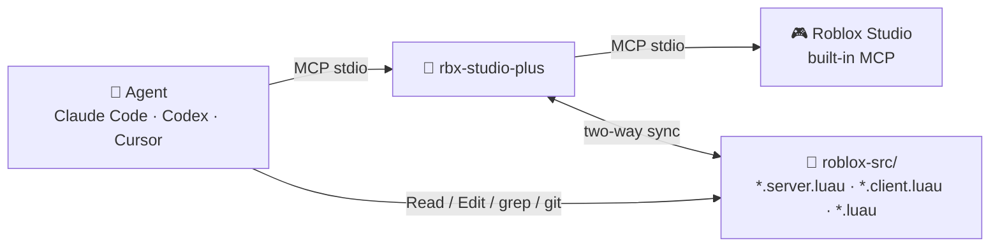

<div align="center">

# 🧱 rbx-studio-plus

**The Roblox Studio MCP server that coding agents actually enjoy using.**

Edit your Roblox scripts as local files, run Luau with real output, playtest in one call. Works with Claude Code, Codex, Cursor, opencode, or any MCP client.

[](https://nodejs.org)
[](tsconfig.json)
[](https://modelcontextprotocol.io)
[](https://create.roblox.com/docs/studio/mcp)
[](LICENSE)

</div>

---

## Why

Roblox Studio ships a built-in MCP server. It is powerful, but it was not designed with coding agents in mind:

- every call needs a `studio_id` and a `datamodel_type`;
- `print()` output is lost;
- results over 100 KB are silently truncated;
- syntax errors only say *"Failed to parse command code"*;
- scripts can only be edited through tool calls, never as files.

**rbx-studio-plus** sits between your agent and Studio and fixes all of that. It also adds the workflow agents are good at: **edit files → push → playtest → read errors → fix**.



## ✨ Highlights

| | Built-in Studio MCP | **rbx-studio-plus** |
|---|---|---|
| 🎯 Targeting | `studio_id` + `datamodel_type` on every call | automatic (or `studio_select` once) |
| 🧪 Running Luau | return value only, `print` lost, arrays mangled, 100 KB cap | `luau_run`: prints, warnings, typed results, clean errors with line numbers, unlimited size |
| 🐛 Syntax errors | *"Failed to parse command code"* | `Syntax error: line 3: Expected identifier…` |
| 📁 Scripts | tool calls only | **two-way file sync** (Rojo layout), 3-way conflict detection, live watch |
| ▶️ Playtesting | start / stop | `playtest`: start → run code → collect errors → stop, **PASS / FAIL** in one call |
| 📜 Output | whole log, no levels | `console`: only new lines, `[E]` / `[W]` levels, regex filter |
| 🛠️ Editing | raw Luau | `set_props` with smart value conversion, `instance`, `selection`, `history` (undo/redo), `script_check` |

Every other Studio tool (`generate_mesh`, `insert_asset`, `screen_capture`, input simulation, `subagent`…) is still available under the same name, without `studio_id`.

## 🚀 Quick start

**1. Enable Studio's MCP server.** In Roblox Studio, go to *Assistant → … → Manage MCP Servers* and turn on **Enable Studio as MCP server**.

**2. Install.**

```sh
git clone https://github.com/noan-hbt/rbx-studio-plus.git
cd rbx-studio-plus
npm install && npm run build
node dist/src/index.js install      # registers "roblox-plus" in Claude Code + Codex
```

**3. Restart your agent**, then ask it something like *"pull the scripts and playtest the game"*.

<details>
<summary>Other MCP clients (Cursor, Claude Desktop, VS Code…)</summary>

```json
{
  "mcpServers": {
    "roblox-plus": {
      "command": "node",
      "args": ["/absolute/path/to/rbx-studio-plus/dist/src/index.js"]
    }
  }
}
```

Use `install --claude` or `install --codex` to register in only one of them.
</details>

## 🧰 Tools

| Tool | What it does |
|---|---|
| `studio_status` | **Start here.** Connected studios, play mode, datamodels, sync state |
| `studio_select` | Pick one Studio when several are open |
| `luau_run` | Run Luau (inline or a local `.luau` file), get output + result + errors |
| `console` | New Output lines since the last call; `level`, `filter` (`/regex/`), `tail` |
| `play` | `start` / `stop` / `status` (waits for the switch) |
| `playtest` | Start the game, run optional code on server or client, collect errors, stop → **PASS / FAIL** |
| `tree` | Compact hierarchy, or flat search with `class` / `name` filters |
| `inspect` | Properties, attributes and children of an instance (optionally a subset) |
| `set_props` | Set properties/attributes, e.g. `Size: [2,3,4]`, `Material: "Neon"`, `Color: "#ff0000"` |
| `instance` | `create` / `delete` / `move` / `clone` / `rename` (all undoable) |
| `script_read` · `script_write` · `script_edit` | Read with line numbers, full replace (creates parents), exact search/replace |
| `script_check` | Compile every script, list syntax errors |
| `selection` | Read or set what the user has selected in Studio |
| `history` | Undo / redo |
| `sync_pull` · `sync_push` · `sync_status` · `sync_watch` | Script ↔ file sync |

Paths accept `Workspace.Model.Part`, `game.Workspace…` or `Workspace/Model/Part`. Duplicate sibling names are addressed as `Name~2`.

## 📁 Script sync

```text
roblox-src/
├── ServerScriptService/
│   └── Main/
│       ├── init.server.luau      ← Script "Main" (it has children)
│       └── Helper.luau           ← ModuleScript
├── StarterPlayer/StarterPlayerScripts/
│   └── Client.client.luau        ← LocalScript
└── .rbxsync.json                 ← sync state (do not edit)
```

- **`sync_pull`** exports every script, by default to `./roblox-src` (or `RBX_SYNC_DIR`). Re-running it only rewrites what changed.
- Edit the files with any tool, then **`sync_push`**. New files become new scripts: the class comes from the suffix and missing Folders are created. Deleted files are removed in Studio only with `delete_missing: true`.
- **No silent overwrites.** If a script changed both locally and in Studio, the push is refused. A pull writes `<file>.studio` next to your file: merge it, delete it, then push with `force: true`.
- **`sync_watch on=true`** turns on live sync: saved files are pushed instantly and Studio edits are pulled every 3 s.
- Each folder is bound to one place. Pulling a different place into it requires `force`.

## 💡 Example

```text
> luau_run  code: "for _, p in workspace.Map:GetChildren() do print(p.Name) end return #workspace:GetDescendants()"

✔ ok · 3 ms · Edit
--- output ---
Spawn
Bunker
Trees
--- result ---
4182
```

```text
> playtest  duration_s: 6

✘ FAIL · ran 8s · 1 error(s), 0 warning(s)
--- console ---
[GameManager] Started
[E] OnClientEvent is not a valid member of RemoteEvent "ReplicatedStorage.Remotes.RoundUpdate"
```

## ⌨️ CLI

The same engine also works without an agent:

```sh
rbx-studio-plus status
rbx-studio-plus sync pull|push|status|watch [--dir D] [--studio S] [--force] [--dry-run] [--delete-missing]
rbx-studio-plus run script.luau [--context server]
```

| Env var | Purpose |
|---|---|
| `RBX_STUDIO` | Default target studio (name substring or place id) |
| `RBX_SYNC_DIR` | Default sync folder |
| `RBX_TIMEOUT_MS` | Per-call timeout (default 60000) |
| `RBX_UPSTREAM_CMD` | JSON array overriding the Studio bridge command |

## 🔧 How it works

- **Studio connection.** rbx-studio-plus is an MCP client of Studio's bridge (`%LOCALAPPDATA%\Roblox\mcp.bat`, or `StudioMCP` on macOS). It reconnects automatically and applies timeouts.
- **Luau execution.** Your code is wrapped in a one-line prelude, so line numbers stay correct. The prelude shadows `print`/`warn`, catches errors with a traceback, and serializes results safely.
- **Large results.** Results bigger than the bridge's limit are **paged** through `_G`. Large inputs are **uploaded in chunks**.
- **Change detection.** Uses the same FNV-1a hash in Luau and in Node, so changes are detected without transferring source.
- **Undo.** Every edit runs inside Studio's change history. Deletions use `Parent = nil` so they can be undone.

## 🧪 Development

```sh
npm test                                      # unit tests
node scripts/live-e2e.mjs <tmp-dir> --playtest # end-to-end against an open Studio
```

The end-to-end test writes only under `ServerStorage.__rbxplus_test` and deletes it at the end.

## 📄 License

[MIT](LICENSE). Not affiliated with Roblox Corporation.
